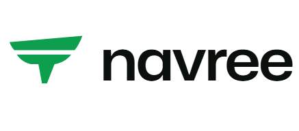
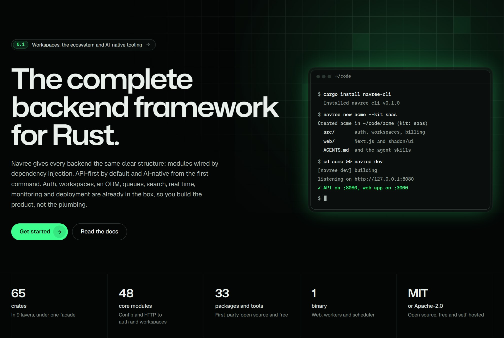
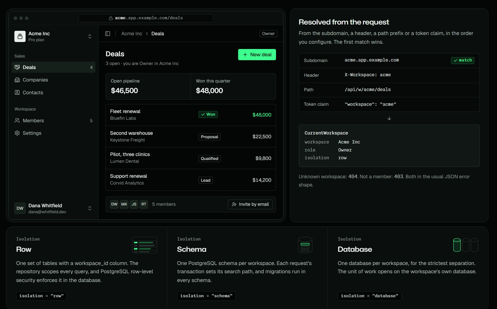
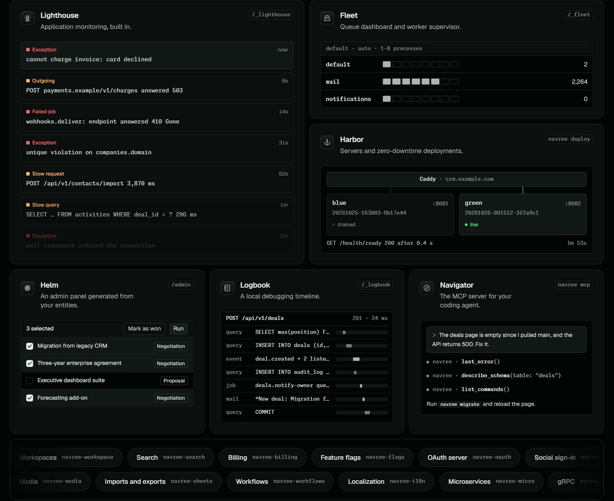
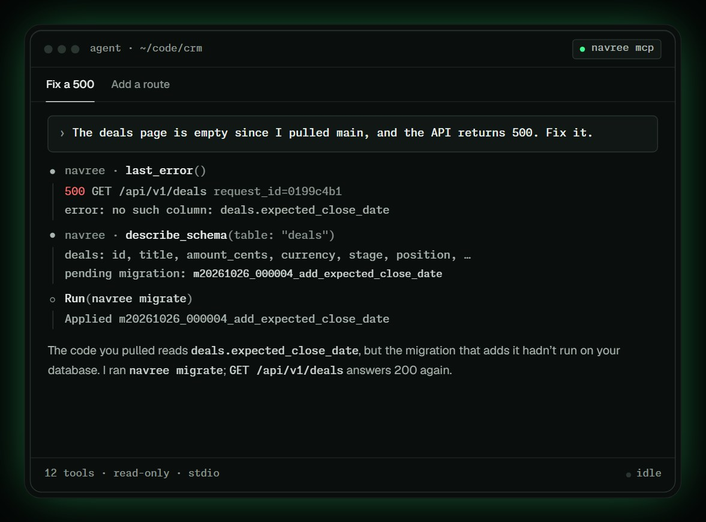
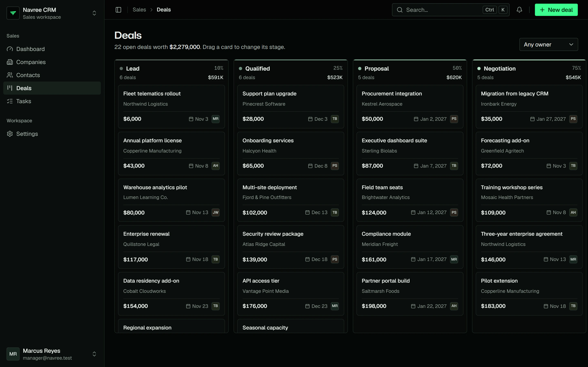
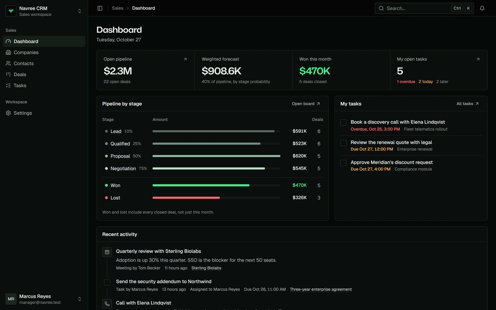
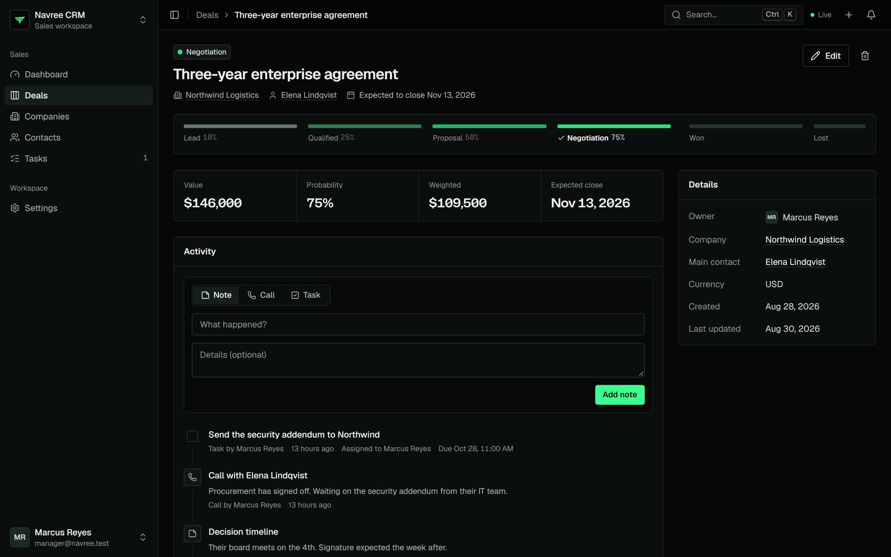

<p align="center">
  <picture>
    <source media="(prefers-color-scheme: dark)" srcset="assets/readme/logo-dark.png">
    <source media="(prefers-color-scheme: light)" srcset="assets/readme/logo-light.png">
    
  </picture>
</p>

<h3 align="center">The complete application framework for Rust.</h3>

<p align="center">
  The backend, the screens and the tools to run them, in one modular,<br>
  AI-native framework. Auth, workspaces, an ORM, queues, search, real time<br>
  and AI are already in the box, so you build the product, not the plumbing.
</p>

<p align="center">
  <a href="https://navree.com/docs/prologue/introduction/"><b>Documentation</b></a>
  &nbsp;·&nbsp;
  <a href="https://navree.com/docs/getting-started/installation/"><b>Get started</b></a>
  &nbsp;·&nbsp;
  <a href="https://navree.com/ui/"><b>Navree UI</b></a>
  &nbsp;·&nbsp;
  <a href="https://navree.com/ecosystem/"><b>Ecosystem</b></a>
  &nbsp;·&nbsp;
  <a href="https://navree.com/showcase/crm/"><b>Showcase</b></a>
  &nbsp;·&nbsp;
  <a href="https://navree.com/ai/"><b>Navree for AI</b></a>
</p>

<p align="center">
  
  
  
  <a href="https://navree.com/llms.txt"></a>
</p>

<br>

<a href="https://navree.com"></a>

## Why Navree

Navree is a framework for complete applications: the API, the background
work, the screens and the tools that keep it all running. Every app has the
same clear structure. Features live in modules that declare what they
import, provide and export, and a dependency-injection container wires them
together when the app boots, refusing to start if anything is missing.
Around that structure sits everything a product needs, designed, documented
and released together.

- **Modular by design.** An app is a set of modules with checked
  boundaries. Nothing is global, so the code stays easy to test, to change
  and to hand to a new teammate or a coding agent.
- **API-first.** Versioned routes, validated input, one JSON error shape
  with stable codes your front end can translate, and an OpenAPI 3.1
  document generated from your code.
- **Secure by default.** Routes deny until you allow them. Rotating refresh
  tokens, two-factor, passkeys, Argon2id, encrypted cookies, rate limits,
  security headers, an audit log and an SSRF guard are on from the start.
- **Multi-tenant from the first commit.** Workspaces and organizations with
  members, roles and invitations, isolated by row, schema or database.
- **Screens your way.** Navree UI renders typed Rust components to HTML on
  the server, with a strict content security policy and a server-side
  DataTable. Or put a Next.js or Nuxt app beside the same API.
- **The tools to run it.** Monitoring, an admin panel, a queue supervisor
  and a debugging timeline are first-party and served by your own app.
- **AI-native.** Agent skills, an MCP server for your coding agent, docs
  written for models as well as people, and an AI SDK for your product.
- **Bring what you have.** Agent skills rebuild an existing product, with
  its data, as a Navree app, or turn a design into Navree UI pages.
- **One binary.** Web server, queue workers and scheduler ship as one
  release, built on Tokio, Hyper, Tower and rustls.

## Get started

```sh
cargo install --git https://github.com/NavreeHQ/navree navree-cli

navree new agra --kit saas     # API and Next.js app: sign-in, workspaces, billing, admin
cd agra
navree dock up                 # TimescaleDB and Mailpit
navree migrate:fresh --seed    # tables and a demo workspace
pnpm --dir web install
navree dev                     # API on :8080, web app on :3000
```

Three starter kits come with the CLI: `saas` (an API with a Next.js front
end), `api` (the API on its own) and `micro` (a microservice). `navree new
blog` starts from a minimal app instead. The
[installation guide](https://navree.com/docs/getting-started/installation/)
and the [starter kits](https://navree.com/docs/getting-started/starter-kits/)
walk through each one.

## Every app reads the same way

A module states its boundaries, and `main.rs` lists the modules:

```rust
use navree::prelude::*;

/// The sales pipeline: its routes, its service, and what
/// other modules may use.
#[module(
    imports = [CrmCoreModule],
    providers = [DealService],
    controllers = [DealsController],
    exports = [DealService],
    register = Self::wire,
)]
pub struct DealsModule;

impl DealsModule {
    fn wire(&self, m: &mut ModuleBuilder) {
        // A queue worker tells owners about their deals.
        m.listen::<DealAssigned, NotifyDealOwner>()
            .on::<DealWon, NotifyDealOwner>();
    }
}

fn main() -> Result<(), BoxError> {
    Navree::app()
        .module(ConfigModule::for_root(ConfigSources::defaults()))
        .module(HttpModule::from_config())
        .module(DatabaseModule::from_config())
        .module(QueueModule::from_config())
        .module(AuthModule::from_config())
        // ... mail, access and the rest of the platform
        .module(DealsModule)
        .run()
}
```

Models are structs the compiler checks, with a typed constant per column:

```rust
/// A deal: the `deals` table, one typed column constant per field.
#[derive(Model, Clone, Debug, Default, Serialize)]
#[model(timestamps, soft_deletes)]
pub struct Deal {
    pub id: Uuid,
    pub company_id: Uuid,
    pub title: String,
    pub amount_cents: i64,
    #[model(cast = "string_enum")]
    pub stage: Stage,
    pub created_at: DateTime<Utc>,
    pub updated_at: DateTime<Utc>,
    pub deleted_at: Option<DateTime<Utc>>,
}

// Won deals over $1,000, newest first, with their companies:
// one query for the page's companies, however long the page.
let won = Deal::query()
    .where_(Deal::STAGE.eq(Stage::Won))
    .where_(Deal::AMOUNT_CENTS.gte(100_000))
    .with("company")
    .latest()
    .paginate(&uow, page)
    .await?;
```

## Everything in the box

| | |
|---|---|
| **Data** | An ORM with relations, eager loading, scopes, casts, lifecycle events and factories; a schema builder and migrations; PostgreSQL, TimescaleDB (the default), MySQL, MariaDB, SQLite (opt-in) and MongoDB |
| **Identity** | JWT with rotating refresh tokens, two-factor, passkeys, magic links, sessions, impersonation, single sign-on (SAML and OpenID Connect), social sign-in and an OAuth 2.1 server |
| **Tenancy** | Workspaces and organizations, roles and abilities, invitations, row, schema or database isolation, custom domains with automatic TLS and SCIM directory sync |
| **APIs** | Versioned REST routes, validation, OpenAPI 3.1, GraphQL, gRPC, microservices over NATS, Kafka or RabbitMQ, and signed webhooks in both directions |
| **Background work** | Queues with retries and batches, scheduling in any time zone, events, and durable workflows with end-user automations |
| **Messaging** | Mail (SMTP, SES, Postmark and more) in and out, notifications over Slack, Microsoft Teams, SMS, WhatsApp and web push with per-user preferences, and real time over WebSockets |
| **Files** | Storage on S3, Google Cloud and Azure, media with image conversions, PDF and DOCX documents, and CSV and Excel imports and exports |
| **Product** | Billing with Stripe and Paddle, feature flags, typed settings with inheritance, full-text and vector search, localization and time zones |
| **AI** | An AI SDK for Anthropic, OpenAI, Gemini, Mistral, Ollama and Bedrock, agents with typed tools, embeddings and vector stores, and MCP servers |
| **UI** | Navree UI: typed Rust components rendered on the server, forms from validated structs, an app shell and a server-side DataTable; or Next.js and Nuxt beside the API |
| **Operations** | Monitoring, a debugging timeline, a queue supervisor, an admin panel, zero-downtime deploys, health checks, metrics and tracing |

## Multi-tenant from the first commit

Workspaces are a core module, on by default: members, roles, invitations
and workspace-scoped permissions come with them. The workspace is resolved
from the subdomain, a header, the path or a token claim, and every query
knows which one it runs in.

<a href="https://navree.com/docs/workspaces/introduction/"></a>

## The ecosystem

Monitoring, queue supervision, deployment, an admin panel, a debugger and an
MCP server for your agent ship with Navree, next to libraries for search,
billing, OAuth, AI and more. All first-party, open source and self-hosted.

<a href="https://navree.com/ecosystem/"></a>

| Tool | What it does |
|---|---|
| **Lighthouse** | Application monitoring inside your app: issues, slow requests and queries, failed jobs and alerts |
| **Logbook** | A local debugging timeline of every request, with its queries, events, jobs and mail |
| **Fleet** | A queue dashboard and a supervisor for your workers |
| **Helm** | An admin panel generated from your models, checked against your access rules |
| **Harbor** | Server provisioning and zero-downtime, blue-green deployments with automatic rollback |
| **Dock** | Local services for development: databases, mail, search and object storage |
| **Navigator** | The MCP server that shows your coding agent the running app |

## Built for developers and their agents

Every Navree app has one predictable shape, so a coding agent finds its way
the first time. Skills give it the steps for each task, Navigator shows it
the running app, and your product gets AI models behind one typed service.

<a href="https://navree.com/ai/"></a>

- **Agent skills**, one per common task, installed with `navree skills:install`.
- **Navigator** (`navree mcp`) gives your agent the routes, the schema, the logs and the last error of the running app.
- **Docs for models**: [`llms.txt`](https://navree.com/llms.txt) and every page as Markdown.
- **AGENTS.md** in every new app.
- **Two ways in**: [bring your product](https://navree.com/docs/getting-started/bring-your-product/)
  rebuilds an old product, with its data, as a Navree app, and
  [bring your design](https://navree.com/docs/getting-started/bring-your-design/)
  turns a mock-up, an export or screenshots into Navree UI pages.

## A real CRM, built on Navree

The repository includes a complete CRM: a Navree API with companies,
contacts, a deals pipeline, tasks, an activity timeline, roles and an audit
log, and two front ends on the same API, one in Next.js and one in Nuxt.

<a href="https://navree.com/showcase/crm/"></a>

<table>
  <tr>
    <td width="50%"></td>
    <td width="50%"></td>
  </tr>
</table>

## Screens and front ends

[Navree UI](https://navree.com/ui/) is the `ui` feature of
`navree`, on by default. A handler returns typed components and the toolkit
renders them to HTML on the server, with one stylesheet, a small runtime
that loads only what a page uses, and a strict content security policy.
Every [component](https://navree.com/docs/components/overview/) has a live
preview in the docs. Navree UI grows one module at a time, and
[Coming next](https://navree.com/docs/ui/coming-next/) lists what is still
to come.

Navree is also API-first and works with any front end. For web apps, the npm
packages in [`packages/js`](packages/js) add a typed client generated from
your OpenAPI document, a backend-for-frontend that keeps tokens in httpOnly
cookies, Next.js and Nuxt integrations, and the navree.com theme.

| Package | What it does |
|---|---|
| `@navree/client` | A typed API client with workspaces, pagination, abilities and real time |
| `@navree/bff` | Token cookies, refresh, two-factor sign-in and a streaming proxy |
| `@navree/next` | Route handlers, server components, data tables and real-time hooks for Next.js |
| `@navree/nuxt` | The same for Nuxt, as a module with auto-imported composables |
| `@navree/theme` | The navree.com dark theme for Tailwind CSS 4, shadcn/ui and shadcn-vue |

## Learn more

- [Documentation](https://navree.com/docs/prologue/introduction/): guides
  and reference for every module.
- [Choosing a UI](https://navree.com/docs/ui/choosing-a-ui/): Navree UI,
  Next.js or Nuxt, and what each costs and gives.
- [The ecosystem](https://navree.com/ecosystem/): every first-party tool and
  package.
- [The CRM showcase](https://navree.com/showcase/crm/): screenshots and a
  tour of the reference app.
- [Agent skills](skills/): one per common task, for your coding agent.

## Contributing

[`CONTRIBUTING.md`](CONTRIBUTING.md) explains how this repository is laid
out and how to build and test it.

## License

Navree is free and open source under either of the
[MIT license](LICENSE-MIT) or the [Apache License 2.0](LICENSE-APACHE), at
your option.
